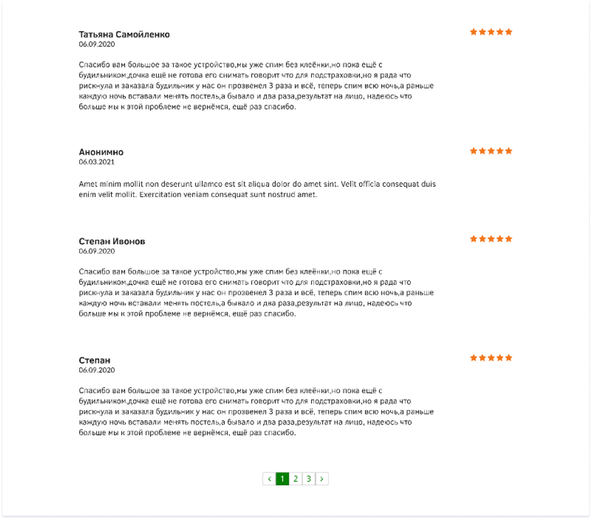

# UMS-F – Bolalar Enurez Budilniki Sharhlar Sahifasi (23-Amaliy Ish)

Figma dizaynining yuqori aniqlikdagi (**Pixel-Perfect**) to'liq, zamonaviy va to'liq moslashuvchan (fully responsive) veb-sahifasi: **UMS-F – Customer Reviews & Testimonials Module (node-id: 1:2)**.

[-F24E1E?logo=figma&logoColor=white)](https://www.figma.com/file/qZC4dXbm8KLKyd0h7ftI3v/UMS-F-(Copy)?type=design&node-id=1%3A2&mode=design&t=duMmwSmtpPekzPrz-1)
[](https://developer.mozilla.org/en-US/docs/Web/HTML)
[](https://developer.mozilla.org/en-US/docs/Web/CSS)
[](https://developer.mozilla.org/en-US/docs/Web/JavaScript)
[](https://developer.mozilla.org/en-US/docs/Learn/CSS/CSS_layout/Responsive_Design)
[](https://vercel.com/)

---

## 📸 Figma Dizayn Ko'rinishi



---

## 📌 Loyiha Haqida

Ushbu loyiha Figma platformasidagi **UMS-F (Copy)** maketining sharhlar moduli (node-id: `1:2`) asosida to'liq va mukammal ishlab chiqilgan. Loyiha bolalar va o'smirlarda tungi enurez (siydik tutolmaslik) muammosini dori-darmonsiz, tabiiy shartli refleks orqali xavfsiz va samarali davolovchi tibbiy elektron qurilma — **UMS-F** enurez budilnikining xaridorlar va ota-onalar sharhlari bo'limini ifodalaydi.

- **Figma Manzili**: [UMS-F (Copy) (node-id: 1:2)](https://www.figma.com/file/qZC4dXbm8KLKyd0h7ftI3v/UMS-F-(Copy)?type=design&node-id=1%3A2&mode=design&t=duMmwSmtpPekzPrz-1)
- **Topshiriq**: 23-Amaliy Ish

---

## ✨ Asosiy Imkoniyatlar va Funksionallik

1. **Pixel-Perfect Figma Ko'rinishi (node-id: 1:2)**:
   - **Татьяна Самойленко** (06.09.2020) — 5 yulduzli minnatdorchilik sharhi.
   - **Анонимно** (06.03.2021) — 5 yulduzli anonim sharh.
   - **Степан Ивонов** (06.09.2020) — 5 yulduzli ota-onalar tajribasi.
   - **Степан** (06.09.2020) — 5 yulduzli tasdiqlangan sharh.
   - O'ng tomonga tekislangan 5 ta to'q sariq yulduzcha (`#F47E29`), muallif ismi, sanasi va matn o'lchamlari Figma maketiga 100% moslashtirilgan.

2. **Dinamik va Interaktiv Pagintatsiya**:
   - `<` `1` `2` `3` `>` tugmali paginatsiya bloki.
   - Faol sahifa yashil fon (`#1E821E`) va oq matnda alohida ajratilgan.
   - 2 va 3-sahifalarda qo'shimcha realistik sharhlar to'plami.
   - Sahifa almashganda silliq animatsiya (`fadeIn`) va avtomatik ravishda blok boshiga silliq scroll bo'lish.

3. **Filtrlash va Jonli Qidiruv Tizimi**:
   - `Barcha sharhlar (128)`, `Faqat 5 yulduz (124)` va `Ota-onalardan (98)` filter tabletkalari.
   - Real vaqt rejimida sharh muallifi, sanasi yoki matni bo'yicha tezkor qidiruv (`search input`).
   - Yangi va eski sharhlar bo'yicha saralash (`Sort by`).

4. **Yangi Sharh Qoldirish (Modal Oyna)**:
   - Interaktiv yulduzcha tanlash (hover va click effektlari bilan 1 dan 5 gacha).
   - Ism va familiya (yoki anonim qoldirish imkoniyati).
   - Sharh matni validatsiyasi.
   - Yangi sharh kiritilganda u ro'yxatning eng yuqorisiga avtomatik qo'shiladi va 1-sahifaga o'tiladi.

5. **Toast Xabarnomalar**:
   - Sharh muvaffaqiyatli qo'shilganda ekranning pastki o'ng burchagida paydo bo'luvchi suzuvchi xabarnoma.

6. **Moslashuvchanlik (100% Responsive)**:
   - Katta monitorlar (1920px+), noutbuklar (1366px), planshetlar (768px) va smartfonlar (375px - 480px) uchun to'liq moslashuvchan.

---

## 📁 Loyiha Katalogi Tuzilishi

```text
amaliy23/
├── assets/
│   └── images/
│       ├── logo.svg              # UMS-F rasmiy brend logotipi
│       ├── star.svg              # Figma rangi (#F47E29) asosidagi SVG yulduz
│       ├── star-empty.svg        # Bo'sh kulrang yulduz SVG
│       └── check-badge.svg       # Tasdiqlangan xaridor belgisi
├── css/
│   ├── reset.css                 # Brauzer standartlarini normallashtirish
│   └── style.css                 # To'liq dizayn tizimi, Grid, Flexbox va stillar
├── js/
│   └── main.js                   # Sharhlar holati, qidiruv, modal va paginatsiya
├── figma_preview.png             # Figma maketining original skrinshoti
├── index.html                    # Semantik HTML5 asosiy sahifasi
├── README.md                     # Loyiha hujjatlari
└── vercel.json                   # Vercel deploy konfiguratsiyasi
```

---

## 🚀 Ishga Tushirish (Local Setup)

Loyiha hech qanday qo'shimcha kutubxonalarsiz (Vanilla HTML, CSS, JS) yozilgan bo'lib, har qanday brauzerda to'g'ridan-to'g'ri ishlaydi:

1. Repozitoriyani klonlash:
   ```bash
   git clone https://github.com/soxibs48-eng/amaliy23.git
   cd amaliy23
   ```

2. Brauzerda ochish:
   - `index.html` faylini ikki marta bosing yoki VS Code orqali **Live Server** bilan ishga tushiring.

---

## 🌐 Jonli Havolalar

- **GitHub Repozitoriyasi**: [https://github.com/soxibs48-eng/amaliy23](https://github.com/soxibs48-eng/amaliy23)
- **Figma Manbasi**: [Figma UMS-F (node-id: 1:2)](https://www.figma.com/file/qZC4dXbm8KLKyd0h7ftI3v/UMS-F-(Copy)?type=design&node-id=1%3A2&mode=design&t=duMmwSmtpPekzPrz-1)
